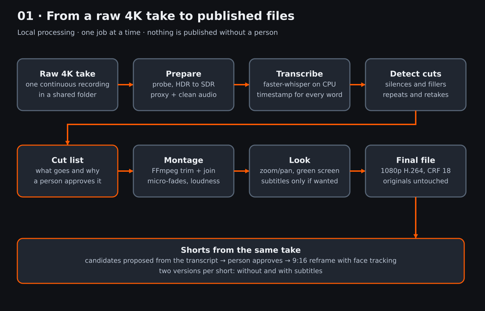

# Architecture

[Versión en español](architecture.md)



## Principles

- **One continuous take, everything else automatic.** The person records once, without stopping, and drops the file in a shared folder.
- **Local only.** Face and voice are biometric data: no cloud editor, cloud transcription or upload. Only transcript *text* may reach a language-model assistant.
- **Propose, then approve.** The cut list and the short candidates are shown first. Nothing is rendered or published without a person's OK.
- **Decode once, encode once.** Cuts, zooms, background and subtitles are applied in a single pass from the original, so quality is not lost to chained re-encodes.
- **One heavy job at a time**, at low priority, so the machine keeps serving everything else.

## Stages

| # | Stage | Input | Output |
|---|---|---|---|
| 1 | Prepare | raw 4K file | probe report, SDR analysis proxy, clean audio |
| 2 | Transcribe | clean audio | words with start and end times |
| 3 | Detect cuts | transcript, audio levels | machine cuts: silence, filler, repeat |
| 4 | Read transcript | transcript text | retakes and short candidates, added by an assistant or a person |
| 5 | Cut list | all cuts | JSON list with reason and time, shown for approval |
| 6 | Montage | original + approved list | trimmed video, micro-fades, loudness normalised |
| 7 | Look | montage + face track | zoom/pan, optional green-screen background, optional subtitles |
| 8 | Final | all of the above | 1080p H.264 file |
| 9 | Shorts | approved candidates | 9:16 files, with and without subtitles |

## The cut list

`src/cuts.py` builds the machine part of stage 5 from a word-level transcript. Each cut has a reason (`silence`, `filler`, `repeat`, or a reviewer's own) and times. Overlaps are merged and the kept segments become an FFmpeg filter graph with a 20 ms audio fade at each join.

```bash
python3 src/cuts.py examples/transcript.example.json
python3 src/cuts.py examples/transcript.example.json --filter
```

On the bundled example the tool removes the filler *"eh"*, the repeated phrase *"vamos a"*, a 1.5 s pause and *"o sea"*: four cuts, 2.5 s of 7 s. A retake is added by passing a reviewer's list with `--extra-cuts`.

## Queue and priorities

A single worker runs one job at a time, in three lanes: *long*, *shorts* and *analysis*. Long videos and shorts run at night or on weekends; rendering uses `nice` and `ionice` so other services on the machine keep responding. A job that fails stops and reports; it never retries silently.

## What is never automatic

- Deleting the original recording.
- Publishing anything anywhere.
- Rendering before the cut list is approved.
- Sending audio or video to an outside service.
