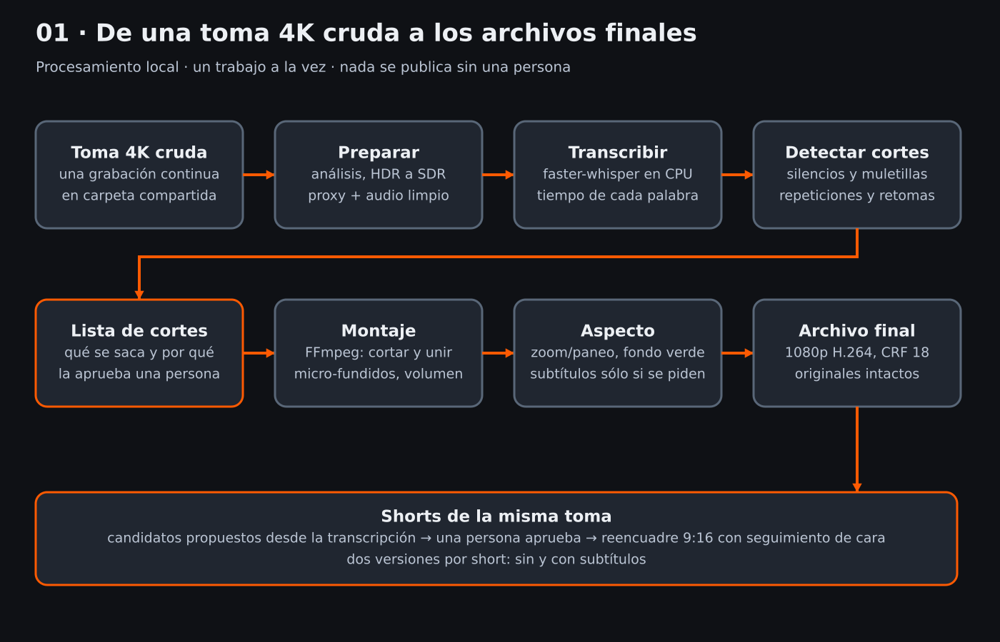

# Arquitectura

[English version](architecture.en.md)



## Principios

- **Una toma continua, todo lo demás automático.** La persona graba una vez, sin cortar, y deja el archivo en una carpeta compartida.
- **Sólo local.** La cara y la voz son datos biométricos: nada de editores en la nube, transcripción en la nube ni subidas. Sólo el *texto* de la transcripción puede llegar a un asistente de lenguaje.
- **Proponer y después aprobar.** Primero se muestran la lista de cortes y los candidatos a short. Nada se renderiza ni se publica sin el OK de una persona.
- **Decodificar una vez, codificar una vez.** Cortes, zooms, fondo y subtítulos se aplican en una sola pasada desde el original, así no se pierde calidad por recompresiones encadenadas.
- **Un trabajo pesado a la vez**, con baja prioridad, para que la máquina siga atendiendo todo lo demás.

## Etapas

| # | Etapa | Entrada | Salida |
|---|---|---|---|
| 1 | Preparar | archivo 4K crudo | informe de análisis, proxy SDR, audio limpio |
| 2 | Transcribir | audio limpio | palabras con tiempo de inicio y fin |
| 3 | Detectar cortes | transcripción, niveles de audio | cortes automáticos: silencio, muletilla, repetición |
| 4 | Leer la transcripción | texto de la transcripción | tomas falladas y candidatos a short, agregados por un asistente o una persona |
| 5 | Lista de cortes | todos los cortes | lista JSON con motivo y tiempo, mostrada para aprobar |
| 6 | Montaje | original + lista aprobada | video recortado, micro-fundidos, volumen normalizado |
| 7 | Aspecto | montaje + seguimiento de cara | zoom/paneo, fondo verde opcional, subtítulos opcionales |
| 8 | Final | todo lo anterior | archivo 1080p H.264 |
| 9 | Shorts | candidatos aprobados | archivos 9:16, con y sin subtítulos |

## La lista de cortes

`src/cuts.py` arma la parte automática de la etapa 5 a partir de una transcripción con tiempo por palabra. Cada corte tiene un motivo (`silence`, `filler`, `repeat` o el de quien revisa) y sus tiempos. Los solapes se unen y los tramos que quedan pasan a un grafo de filtros de FFmpeg con un fundido de audio de 20 ms en cada unión.

```bash
python3 src/cuts.py examples/transcript.example.json
python3 src/cuts.py examples/transcript.example.json --filter
```

En el ejemplo incluido la herramienta saca la muletilla *"eh"*, la frase repetida *"vamos a"*, una pausa de 1,5 s y *"o sea"*: cuatro cortes, 2,5 s de 7 s. Una toma fallada se agrega pasando la lista de quien revisa con `--extra-cuts`.

## Cola y prioridades

Un único trabajador corre un trabajo a la vez, en tres carriles: *largo*, *shorts* y *análisis*. Los videos largos y los shorts corren de noche o en fin de semana; el render usa `nice` e `ionice` para que los demás servicios de la máquina sigan respondiendo. Un trabajo que falla se detiene y avisa; nunca reintenta en silencio.

## Qué nunca es automático

- Borrar la grabación original.
- Publicar algo en cualquier lado.
- Renderizar antes de aprobar la lista de cortes.
- Enviar audio o video a un servicio externo.
