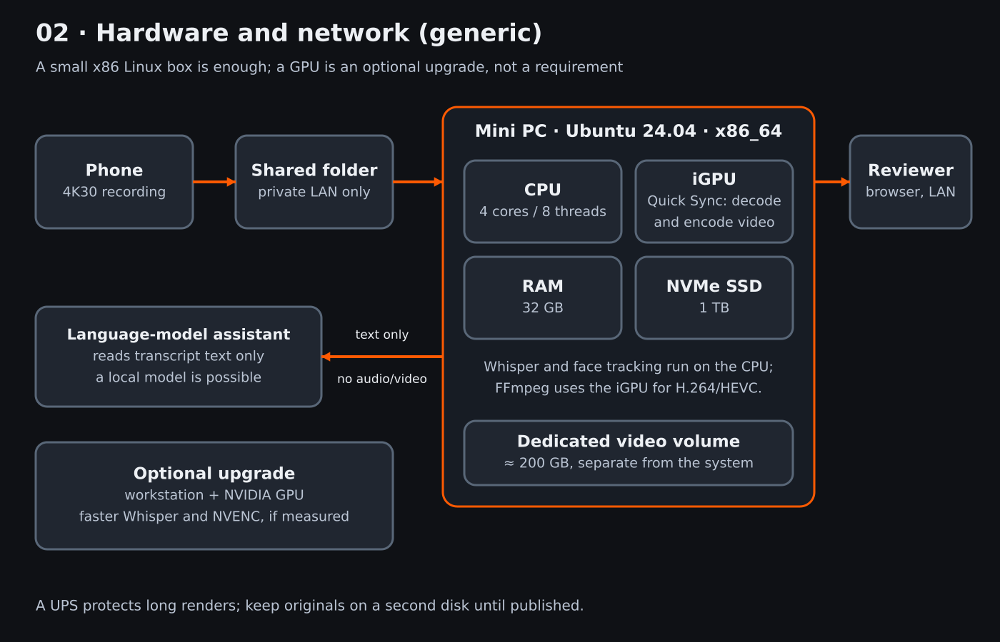

# Hardware proposal

[Versión en español](hardware.md)

## Standard home hardware

The proposal deliberately uses ordinary home equipment, not a workstation: the finished video is 1080p and the price paid is processing time, which is absorbed by running overnight (see [timing](timing.en.md) and [modes](modes.en.md)).

## Reference machine

| Part | Proposal | Why |
|---|---|---|
| Computer | mini PC, x86_64, Ubuntu 24.04 | quiet, low power, runs all the tools |
| CPU | 10th-gen Intel U-series or newer, 4 cores / 8 threads | Whisper and face tracking run here |
| Integrated GPU | Intel UHD with Quick Sync | hardware decode of the 4K source and encode of the 1080p result |
| RAM | 32 GB (16 GB is the working minimum) | the 4K decode, a Whisper model and FFmpeg at once |
| Storage | NVMe SSD, 1 TB | scratch space for 4K is large |
| Discrete GPU | none | mini PCs usually cannot take one |
| Power | a UPS | a long render must not die on a short outage |

A capture phone shooting 4K30, a good light and a lavalier microphone matter more than the computer: clean audio makes transcription faster and more accurate.

## Storage sizing

| Item | Size, 30 min of 4K30 (estimate) |
|---|---|
| Raw original (HEVC, about 45 Mbps) | 8–12 GB |
| Analysis proxy and clean audio | 1–2 GB |
| Temporary files during render | up to about 10 GB |
| Final 1080p file | 2–4 GB |
| Each short | 50–100 MB |

A dedicated video volume of about 200 GB (separate from the system disk, mounted `nodev,nosuid`) holds a weekly rhythm with originals kept for two weeks after publishing. Originals are removed only after confirmation.

## Upgrade path

Only if the measured volume demands it. A workstation with an NVIDIA GPU makes Whisper and encoding several times faster; the pipeline does not change, only the stage rates in the [timing model](timing.en.md). Measure before buying.

## Network and access

Phone to the machine through a private shared folder; a reviewer reads the cut list and previews in a browser on the same private network. Nothing in the pipeline needs to be reachable from the internet. For remote access, use an authenticated tunnel, never an open port.

## Thermals

A small chassis throttles under a sustained load. Keep the fan path clear, use a low-priority queue and check temperatures during the first long render.
