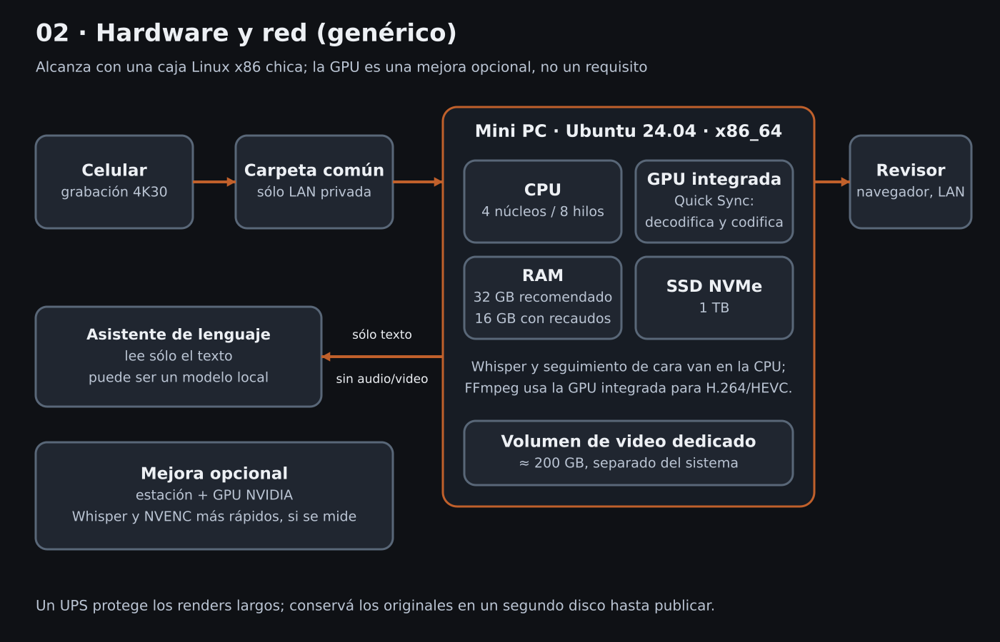

# Propuesta de hardware

[English version](hardware.en.md)

## Hardware estándar hogareño

La propuesta usa a propósito equipos comunes de casa, no una estación de trabajo: el video terminado es 1080p y lo que se paga es tiempo de procesamiento, que se absorbe corriendo de noche (ver [tiempos](timing.md) y [modos](modes.md)).

## Máquina de referencia

| Parte | Propuesta | Por qué |
|---|---|---|
| Computadora | mini PC, x86_64, Ubuntu 24.04 | silenciosa, de bajo consumo, corre todas las herramientas |
| CPU | Intel serie U de 10.ª generación o más nueva, 4 núcleos / 8 hilos | acá corren Whisper y el seguimiento de cara |
| GPU integrada | Intel UHD con Quick Sync | decodifica por hardware el 4K de origen y codifica el 1080p final |
| RAM | 32 GB (16 GB es el mínimo de trabajo) | el decodificado 4K, un modelo de Whisper y FFmpeg a la vez |
| Almacenamiento | SSD NVMe, 1 TB | el espacio temporal del 4K es grande |
| GPU dedicada | ninguna | los mini PC en general no admiten una |
| Energía | un UPS | un render largo no debe morir por un corte corto |

Un celular grabando 4K30, buena luz y un micrófono de solapa importan más que la computadora: el audio limpio hace la transcripción más rápida y más exacta.

## Dimensionado de almacenamiento

| Elemento | Tamaño, 30 min de 4K30 (estimación) |
|---|---|
| Original crudo (HEVC, unos 45 Mbps) | 8–12 GB |
| Proxy de análisis y audio limpio | 1–2 GB |
| Temporales durante el render | hasta unos 10 GB |
| Archivo final 1080p | 2–4 GB |
| Cada short | 50–100 MB |

Un volumen de video dedicado de unos 200 GB (separado del disco del sistema, montado `nodev,nosuid`) sostiene un ritmo semanal con los originales guardados dos semanas después de publicar. Los originales se borran sólo con confirmación.

## Camino de mejora

Sólo si el volumen medido lo exige. Una estación con GPU NVIDIA hace Whisper y la codificación varias veces más rápidos; el pipeline no cambia, sólo las tasas de cada etapa en el [modelo de tiempos](timing.md). Medir antes de comprar.

## Red y acceso

Del celular a la máquina por una carpeta compartida privada; quien revisa lee la lista de cortes y las vistas previas desde un navegador en la misma red privada. Nada del pipeline necesita ser accesible desde internet. Para acceso remoto, un túnel autenticado, nunca un puerto abierto.

## Térmica

Un gabinete chico reduce la velocidad bajo carga sostenida. Dejá libre el paso del aire, usá la cola de baja prioridad y mirá las temperaturas durante el primer render largo.
