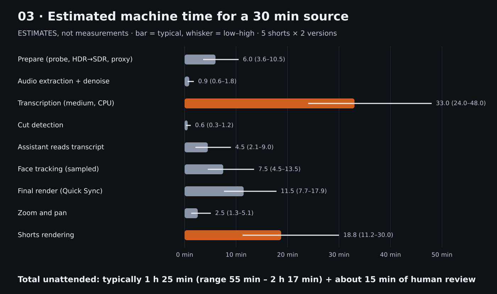

# Time estimates

[Versión en español](timing.md)

> **These numbers are estimates, not measurements.** The pipeline is not built yet. They come from the known behaviour of the tools on this class of hardware, written as a *low – typical – high* range, and live in one file, [`docs/data/timing-model.json`](data/timing-model.json). Replace them with your own measurements.



## How the model works

Each stage has a cost in **minutes of machine time per minute of source video**. Transcription depends on the Whisper model; rendering depends on the encoder (Quick Sync or software x264). Cuts shorten the render by a ratio (15 % by default). Shorts are priced per minute of output and per version.

| Whisper model on this CPU | Cost per source minute (low – typical – high) |
|---|---|
| small | 0.25 – 0.4 – 0.6 |
| medium (default) | 0.8 – 1.1 – 1.6 |
| large-v3 | 2.5 – 3.5 – 5.0 |

## Scenarios

Machine time is unattended. Human review is the extra time a person needs to approve the cut list and the shorts.

| Scenario | Typical | Range |
|---|---|---|
| 10 min source, 2 shorts | 30 min | 19 – 48 min |
| 30 min, no shorts, Whisper small, no zoom | 36 min | 22 – 58 min |
| 30 min, 5 shorts × 2 versions (default) | 1 h 25 min | 55 min – 2 h 17 min |
| 30 min, software x264, green screen, subtitles | 2 h 15 min | 1 h 28 min – 3 h 37 min |
| 30 min, Whisper large-v3 | 2 h 37 min | 1 h 46 min – 3 h 59 min |
| 60 min source, 8 shorts | 2 h 43 min | 1 h 46 min – 4 h 22 min |

For one short of 45 seconds in two versions: about 4 minutes of machine time (2 – 6). Human review: about 8 minutes for the cut list plus about 1 minute per short.

```bash
python3 src/estimate.py 30                                  # default scenario
python3 src/estimate.py 30 --encoder x264 --chroma --subtitles
python3 src/estimate.py 60 --shorts 8 --json
```

## Is it fast enough?

For someone publishing **one video a day**, yes: the work happens overnight and the person only spends the review minutes.

| Daily routine | Machine time, typical (range) | Fits an 8 h night? |
|---|---|---|
| 10 min video, 2 shorts | 30 min (19 – 48 min) | yes, with a wide margin |
| 30 min video, 5 shorts | 1 h 25 min (55 min – 2 h 17 min) | yes |
| 60 min video, 8 shorts | 2 h 43 min (1 h 46 min – 4 h 22 min) | yes, even at the high end |

The cost of home hardware is waiting, not quality. If a result is needed within the hour, a faster machine is the answer; for a nightly routine, it is not needed.

## Where the time goes

Transcription and shorts are the two big blocks. Switching to Whisper *small* or fewer shorts changes the total the most; a discrete GPU would shrink transcription and encoding.

## Measure your own

1. Take a real 5-minute clip. Time each stage on its own: `ffmpeg -benchmark` for decode and encode, a stopwatch around a `faster-whisper` run, and the face-tracking pass.
2. Divide each time by the clip length to get minutes per source minute.
3. Edit the three values (low, typical, high) in the model file and run `src/estimate.py` again.

```bash
ffmpeg -benchmark -hwaccel qsv -c:v hevc_qsv -i clip.mp4 -f null -
ffmpeg -benchmark -hwaccel qsv -c:v hevc_qsv -i clip.mp4 -vf scale_qsv=w=1920:h=1080 -c:v h264_qsv -global_quality 20 -f null -
```
