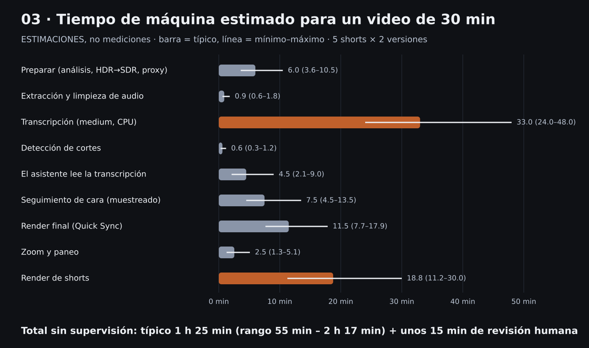

# Estimaciones de tiempo

[English version](timing.en.md)

> **Estos números son estimaciones, no mediciones.** El pipeline todavía no está construido. Salen del comportamiento conocido de las herramientas en esta clase de hardware, escritos como rango *mínimo – típico – máximo*, y viven en un solo archivo, [`docs/data/timing-model.json`](data/timing-model.json). Reemplazalos por tus propias mediciones.



## Cómo funciona el modelo

Cada etapa tiene un costo en **minutos de máquina por minuto de video de origen**. La transcripción depende del modelo de Whisper; el render depende del codificador (Quick Sync o x264 por software). Los cortes acortan el render según una proporción (15 % por defecto). Los shorts se calculan por minuto de salida y por versión.

| Modelo de Whisper en esta CPU | Costo por minuto de origen (mínimo – típico – máximo) |
|---|---|
| small | 0,25 – 0,4 – 0,6 |
| medium (por defecto) | 0,8 – 1,1 – 1,6 |
| large-v3 | 2,5 – 3,5 – 5,0 |

## Escenarios

El tiempo de máquina es sin supervisión. La revisión humana es el tiempo extra que necesita una persona para aprobar la lista de cortes y los shorts.

| Escenario | Típico | Rango |
|---|---|---|
| Origen de 10 min, 2 shorts | 30 min | 19 – 48 min |
| 30 min, sin shorts, Whisper small, sin zoom | 36 min | 22 – 58 min |
| 30 min, 5 shorts × 2 versiones (por defecto) | 1 h 25 min | 55 min – 2 h 17 min |
| 30 min, x264 por software, fondo verde, subtítulos | 2 h 15 min | 1 h 28 min – 3 h 37 min |
| 30 min, Whisper large-v3 | 2 h 37 min | 1 h 46 min – 3 h 59 min |
| Origen de 60 min, 8 shorts | 2 h 43 min | 1 h 46 min – 4 h 22 min |

Para un short de 45 segundos en dos versiones: unos 4 minutos de máquina (2 – 6). Revisión humana: unos 8 minutos para la lista de cortes más cerca de 1 minuto por short.

```bash
python3 src/estimate.py 30                                  # escenario por defecto
python3 src/estimate.py 30 --encoder x264 --chroma --subtitles
python3 src/estimate.py 60 --shorts 8 --json
```

## ¿Alcanza la velocidad?

Para alguien que publica **un video por día**, sí: el trabajo se hace de noche y la persona sólo gasta los minutos de revisión.

| Rutina diaria | Tiempo de máquina, típico (rango) | ¿Entra en una noche de 8 h? |
|---|---|---|
| Video de 10 min, 2 shorts | 30 min (19 – 48 min) | sí, con mucho margen |
| Video de 30 min, 5 shorts | 1 h 25 min (55 min – 2 h 17 min) | sí |
| Video de 60 min, 8 shorts | 2 h 43 min (1 h 46 min – 4 h 22 min) | sí, incluso en el extremo alto |

El costo del hardware hogareño es la espera, no la calidad. Si hace falta el resultado dentro de la hora, la respuesta es una máquina más rápida; para una rutina nocturna no hace falta.

## Dónde se va el tiempo

La transcripción y los shorts son los dos bloques grandes. Pasar a Whisper *small* o hacer menos shorts es lo que más cambia el total; una GPU dedicada achicaría la transcripción y la codificación.

## Medí los tuyos

1. Tomá un clip real de 5 minutos. Cronometrá cada etapa por separado: `ffmpeg -benchmark` para decodificar y codificar, un cronómetro alrededor de una corrida de `faster-whisper` y la pasada de seguimiento de cara.
2. Dividí cada tiempo por la duración del clip para obtener minutos por minuto de origen.
3. Editá los tres valores (mínimo, típico, máximo) en el archivo del modelo y corré `src/estimate.py` otra vez.

```bash
ffmpeg -benchmark -hwaccel qsv -c:v hevc_qsv -i clip.mp4 -f null -
ffmpeg -benchmark -hwaccel qsv -c:v hevc_qsv -i clip.mp4 -vf scale_qsv=w=1920:h=1080 -c:v h264_qsv -global_quality 20 -f null -
```
